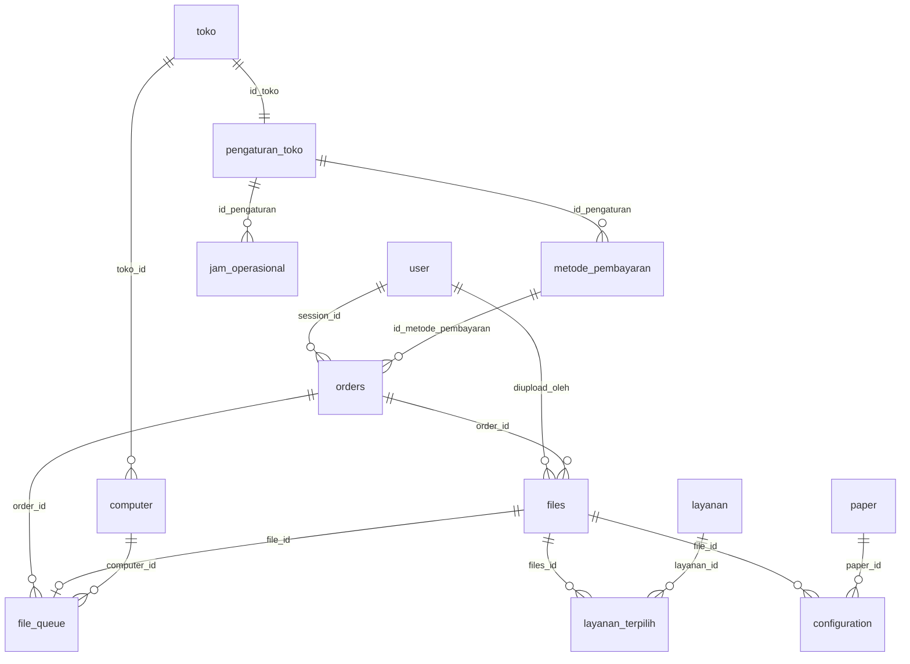

# Database Scheme

Sumber:
- `2026_10_06_025047_create_ziping_tables.php`
- `2026_10_31_120000_add_tanggal_bayar_to_orders_table.php`

Keterangan:
- `PK` = primary key, `FK` = foreign key, `UQ` = unique
- `binary(16)` = UUID dalam bentuk binary (16 byte)
- Tipe `id` biasa = `bigint unsigned auto increment`

---

## ERD

---

## Daftar Tabel

| No | Tabel | Fungsi |
|----|-------|--------|
| 1 | `user` | Pengunjung/pemesan (berbasis session) |
| 2 | `layanan` | Master layanan tambahan |
| 3 | `toko` | Akun toko/tukang print |
| 4 | `paper` | Master ukuran kertas + harga |
| 5 | `computer` | Komputer/printer client milik toko |
| 6 | `pengaturan_toko` | Pengaturan toko |
| 7 | `jam_operasional` | Jam buka per hari |
| 8 | `metode_pembayaran` | Metode pembayaran toko |
| 9 | `orders` | Pesanan |
| 10 | `files` | File yang diupload per pesanan |
| 11 | `layanan_terpilih` | Layanan yang dipilih per file |
| 12 | `configuration` | Konfigurasi cetak per file |
| 13 | `file_queue` | Antrean file ke komputer toko |

---

## 1. `user`

| Kolom | Tipe | Null | Default | Keterangan |
|-------|------|------|---------|------------|
| `sessionid` | string(255) | NO | - | **PK** |
| `name` | string(255) | NO | - | |
| `no_wa` | string(20) | NO | - | Nomor WhatsApp |
| `create_at` | timestamp | NO | `CURRENT_TIMESTAMP` | |

## 2. `layanan`

| Kolom | Tipe | Null | Default | Keterangan |
|-------|------|------|---------|------------|
| `id` | bigint unsigned | NO | auto increment | **PK** |
| `nama` | string(50) | NO | - | |
| `deskripsi` | text | YES | - | |
| `jumlah` | bigint | NO | `0` | |
| `harga` | bigint | NO | `0` | |
| `aktif` | boolean | NO | `false` | |
| `image_path` | string(255) | NO | `"-"` | |
| `tanggal_dibuat` | timestamp | NO | `CURRENT_TIMESTAMP` | |

## 3. `toko`

| Kolom | Tipe | Null | Default | Keterangan |
|-------|------|------|---------|------------|
| `id` | binary(16) | NO | - | **PK** |
| `name` | string(255) | NO | - | |
| `username` | string(50) | NO | - | **UQ** `uq_toko_username` |
| `password` | string(255) | NO | - | |
| `tanggal_dibuat` | timestamp | NO | `CURRENT_TIMESTAMP` | |
| `tanggal_update` | timestamp | NO | `CURRENT_TIMESTAMP` | On update `CURRENT_TIMESTAMP` |
| `token` | binary(32) | YES | - | |

## 4. `paper`

| Kolom | Tipe | Null | Default | Keterangan |
|-------|------|------|---------|------------|
| `id` | bigint unsigned | NO | auto increment | **PK** |
| `name` | string(8) | NO | - | **UQ** `uq_paper_name` |
| `width` | integer | NO | - | |
| `height` | integer | NO | - | |
| `aktif` | boolean | NO | `false` | |
| `harga_color` | bigint | NO | `0` | |
| `harga_grayscale` | bigint | NO | `0` | |

## 5. `computer`

| Kolom | Tipe | Null | Default | Keterangan |
|-------|------|------|---------|------------|
| `id` | binary(16) | NO | - | **PK** |
| `name` | string(100) | NO | - | |
| `token` | binary(16) | NO | - | **UQ** `uq_computer_token` |
| `tanggal_dibuat` | timestamp | NO | `CURRENT_TIMESTAMP` | |
| `toko_id` | binary(16) | NO | - | **FK** → `toko.id` |
| `status` | enum | NO | `not connected` | `not connected`, `shutdown`, `pending`, `connected`, `warning` |

## 6. `pengaturan_toko`

| Kolom | Tipe | Null | Default | Keterangan |
|-------|------|------|---------|------------|
| `id` | bigint unsigned | NO | auto increment | **PK** |
| `status_buka` | boolean | YES | - | |
| `biaya_admin` | bigint | YES | - | |
| `biaya_layanan` | bigint | YES | - | |
| `id_toko` | binary(16) | NO | - | **UQ** `uq_pengaturan_toko`, **FK** → `toko.id` |
| `lama_file_dihapus` | tinyint | NO | `2` | Lama file sebelum dihapus |

## 7. `jam_operasional`

| Kolom | Tipe | Null | Default | Keterangan |
|-------|------|------|---------|------------|
| `id` | bigint unsigned | NO | auto increment | **PK** |
| `nomor_hari` | tinyint | NO | - | **UQ** `uq_jam_Operasional` |
| `hari` | string(10) | NO | - | |
| `waktu_buka` | time | YES | - | |
| `waktu_tutup` | time | YES | - | |
| `apakah_dibuka` | boolean | NO | - | |
| `id_pengaturan` | bigint unsigned | NO | - | **FK** → `pengaturan_toko.id` |

## 8. `metode_pembayaran`

| Kolom | Tipe | Null | Default | Keterangan |
|-------|------|------|---------|------------|
| `id` | binary(16) | NO | - | **PK** |
| `nama` | string(255) | YES | - | |
| `webhook` | text | YES | - | |
| `token` | text | YES | - | |
| `image_path` | text | YES | - | |
| `id_pengaturan` | bigint unsigned | YES | - | **FK** → `pengaturan_toko.id` |

## 9. `orders`

| Kolom | Tipe | Null | Default | Keterangan |
|-------|------|------|---------|------------|
| `id` | binary(16) | NO | - | **PK** |
| `tanggal_pesan` | timestamp | NO | `CURRENT_TIMESTAMP` | Awal hitung mundur batas upload |
| `tanggal_ambil` | datetime | NO | - | |
| `biaya_admin` | bigint | NO | `0` | |
| `total_pembayaran` | bigint | NO | `0` | |
| `total_dibayar` | bigint | NO | `0` | |
| `status_pembayaran` | enum | NO | `pending` | `paid`, `pending`, `failed`, `refunded`, `processing` |
| `metode_pembayaran` | string(255) | YES | - | |
| `id_metode_pembayaran` | binary(16) | YES | - | **FK** → `metode_pembayaran.id` |
| `session_id` | string(255) | YES | - | **FK** → `user.sessionid` |
| `tanggal_bayar` | timestamp | YES | - | Waktu klik "Bayar sekarang" (Snap token dibuat). Awal hitung mundur batas pembayaran. *(migration 2026_10_31)* |

## 10. `files`

| Kolom | Tipe | Null | Default | Keterangan |
|-------|------|------|---------|------------|
| `id` | binary(16) | NO | - | **PK** |
| `name` | text | NO | - | |
| `path` | text | NO | - | |
| `size` | bigint | NO | - | |
| `mime` | enum | NO | `application/octet-stream` | Lihat daftar di bawah |
| `diupload_oleh` | string(255) | YES | - | **FK** → `user.sessionid` |
| `tanggal_dibuat` | timestamp | NO | `CURRENT_TIMESTAMP` | |
| `total_pages` | smallint | YES | - | |
| `order_id` | binary(16) | YES | - | **FK** → `orders.id` |
| `dihapus` | boolean | NO | `false` | |
| `subtotal` | bigint | NO | `0` | |
| `layanan` | enum | NO | - | `kilat-edit`, `kilat-langsung`, `terjadwal` |

Nilai enum `mime`:
- `application/pdf`
- `application/msword`
- `application/octet-stream`
- `application/vnd.openxmlformats-officedocument.wordprocessingml.document`
- `application/vnd.ms-excel`
- `application/vnd.openxmlformats-officedocument.spreadsheetml.sheet`
- `image/jpeg`
- `image/png`

## 11. `layanan_terpilih`

| Kolom | Tipe | Null | Default | Keterangan |
|-------|------|------|---------|------------|
| `id` | bigint unsigned | NO | auto increment | **PK** |
| `files_id` | binary(16) | YES | - | **FK** → `files.id` |
| `layanan_id` | bigint unsigned | YES | - | **FK** → `layanan.id` |
| `nama_layanan` | string(50) | NO | - | |

## 12. `configuration`

| Kolom | Tipe | Null | Default | Keterangan |
|-------|------|------|---------|------------|
| `id` | bigint unsigned | NO | auto increment | **PK** |
| `file_id` | binary(16) | NO | - | **FK** → `files.id` |
| `orientasi` | enum | NO | - | `portrait`, `landscape` |
| `warna` | enum | NO | - | `berwarna`, `hitam putih` |
| `ukuran` | string(255) | NO | - | |
| `kualitas` | enum | NO | - | `rendah`, `standar`, `tinggi` |
| `jumlah_cetak` | smallint | NO | - | |
| `custom_halaman` | text | YES | - | |
| `catatan_tambahan` | text | YES | - | |
| `paper_id` | bigint unsigned | YES | - | **FK** → `paper.id` |
| `pages_toprint` | smallint | NO | `0` | |

## 13. `file_queue`

| Kolom | Tipe | Null | Default | Keterangan |
|-------|------|------|---------|------------|
| `id` | bigint unsigned | NO | auto increment | **PK** |
| `tanggal_dibuat` | timestamp | NO | `CURRENT_TIMESTAMP` | |
| `status` | enum | NO | `pending` | `pending`, `processing`, `completed`, `failed`, `downloading` |
| `path` | text | NO | - | |
| `order_id` | binary(16) | NO | - | **FK** → `orders.id` |
| `file_id` | binary(16) | YES | - | **UQ** `fk_file_id_unique`, **FK** → `files.id` |
| `computer_id` | binary(16) | YES | - | **FK** → `computer.id` |

---

## Foreign Key

| Tabel | Kolom | Referensi | On Update | On Delete |
|-------|-------|-----------|-----------|-----------|
| `computer` | `toko_id` | `toko.id` | CASCADE | CASCADE |
| `pengaturan_toko` | `id_toko` | `toko.id` | CASCADE | CASCADE |
| `jam_operasional` | `id_pengaturan` | `pengaturan_toko.id` | CASCADE | CASCADE |
| `metode_pembayaran` | `id_pengaturan` | `pengaturan_toko.id` | CASCADE | SET NULL |
| `orders` | `id_metode_pembayaran` | `metode_pembayaran.id` | CASCADE | SET NULL |
| `orders` | `session_id` | `user.sessionid` | CASCADE | SET NULL |
| `files` | `diupload_oleh` | `user.sessionid` | CASCADE | SET NULL |
| `files` | `order_id` | `orders.id` | CASCADE | RESTRICT |
| `layanan_terpilih` | `files_id` | `files.id` | CASCADE | SET NULL |
| `layanan_terpilih` | `layanan_id` | `layanan.id` | CASCADE | SET NULL |
| `configuration` | `file_id` | `files.id` | CASCADE | CASCADE |
| `configuration` | `paper_id` | `paper.id` | CASCADE | SET NULL |
| `file_queue` | `order_id` | `orders.id` | CASCADE | CASCADE |
| `file_queue` | `file_id` | `files.id` | CASCADE | SET NULL |
| `file_queue` | `computer_id` | `computer.id` | CASCADE | SET NULL |

---

## Catatan

- `jam_operasional.nomor_hari` dibuat **unique global** (bukan per `id_pengaturan`). Kalau nanti ada lebih dari satu toko, insert jam operasional toko kedua akan bentrok. Pertimbangkan unique composite `(id_pengaturan, nomor_hari)`.
- `orders.tanggal_bayar` ditambahkan di migration terpisah dan nullable. Nilainya `NULL` sampai user menekan "Bayar sekarang".
- `files.order_id` memakai `RESTRICT`, jadi order tidak bisa dihapus selama masih punya file.