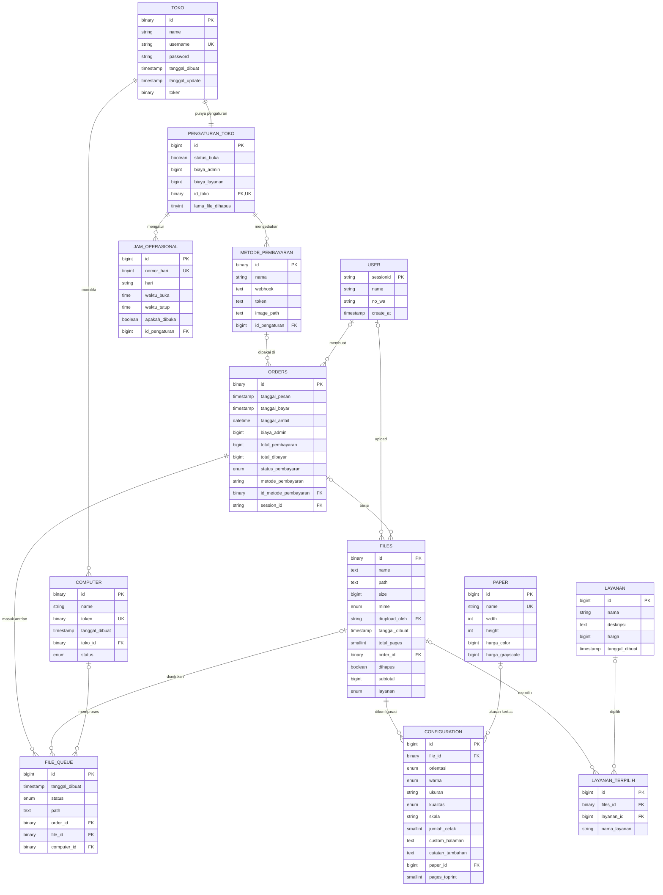

# ERD Database

## Daftar Relasi (Foreign Key)

| Tabel Anak | Kolom FK | Tabel Induk | On Update | On Delete |
|---|---|---|---|---|
| computer | toko_id | toko.id | cascade | cascade |
| pengaturan_toko | id_toko | toko.id | cascade | cascade |
| jam_operasional | id_pengaturan | pengaturan_toko.id | cascade | cascade |
| metode_pembayaran | id_pengaturan | pengaturan_toko.id | cascade | set null |
| orders | id_metode_pembayaran | metode_pembayaran.id | cascade | set null |
| orders | session_id | user.sessionid | cascade | set null |
| files | diupload_oleh | user.sessionid | cascade | set null |
| files | order_id | orders.id | cascade | restrict |
| layanan_terpilih | files_id | files.id | cascade | set null |
| layanan_terpilih | layanan_id | layanan.id | cascade | set null |
| configuration | file_id | files.id | cascade | cascade |
| configuration | paper_id | paper.id | cascade | set null |
| file_queue | order_id | orders.id | cascade | cascade |
| file_queue | file_id | files.id | cascade | set null |
| file_queue | computer_id | computer.id | cascade | set null |

## Nilai Enum

| Tabel.Kolom | Nilai |
|---|---|
| computer.status | not connected, shutdown, pending, connected, warning |
| orders.status_pembayaran | pending, processing, success, fail |
| files.mime | pdf, doc, docx, xls, xlsx, jpeg, png, octet-stream |
| files.layanan | kilat-edit, kilat-langsung, terjadwal |
| configuration.orientasi | potrait, landscape |
| configuration.warna | berwarna, hitam putih |
| configuration.kualitas | rendah, standar, tinggi |
| file_queue.status | pending, processing, completed, failed, downloading |

## Catatan

- `jam_operasional.nomor_hari` bersifat `UNIQUE` secara global, bukan per `id_pengaturan`. Kalau nanti ada lebih dari satu toko, tiap toko tidak bisa punya jam untuk hari yang sama. Sebaiknya diganti unique komposit `(id_pengaturan, nomor_hari)`.
- `configuration.file_id` tidak unique, jadi secara skema satu file bisa punya banyak konfigurasi. Kalau maksudnya 1:1, tambahkan `unique`.